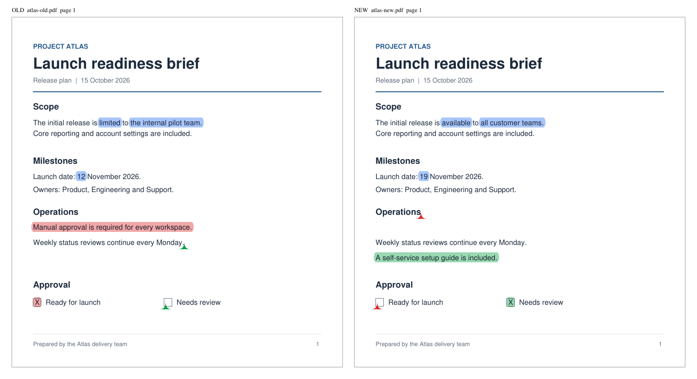
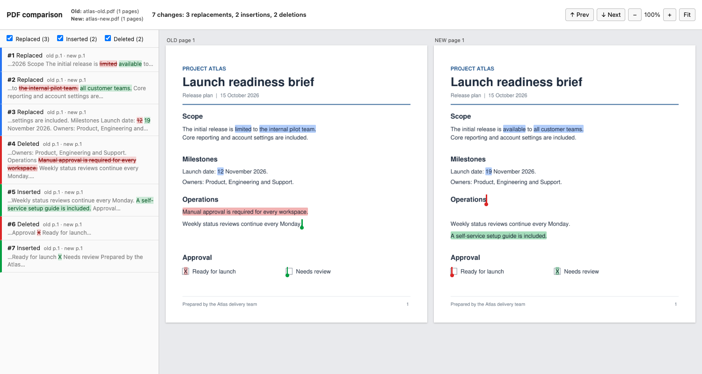

# pdfdiff

Compare the text of two PDFs, similar to Acrobat's *Compare Files*.
It runs entirely offline and makes no network calls.

## Install

```sh
python3 -m venv .venv
.venv/bin/pip install -e '.[dev]'
```

## Usage

```sh
pdfdiff OLD.pdf NEW.pdf                      # terminal report
pdfdiff OLD.pdf NEW.pdf -f term,json         # also write out/OLD_vs_NEW.diff.json
pdfdiff OLD.pdf NEW.pdf -f pdf,combined      # annotated PDFs (see below)
pdfdiff OLD.pdf NEW.pdf -f html              # side-by-side report for a browser
```

| Option | Description |
|---|---|
| `-f, --format` | Comma-separated output formats: `term`, `json`, `pdf`, `combined`, `html` (default: `term`). |
| `-o, --output-dir` | Directory for file outputs, created if needed (default: `out`, which is gitignored). |
| `--ignore-case` | Ignore letter case. |
| `--ignore-punctuation` | Ignore punctuation. |
| `--no-dehyphenate` | Don't join words that are hyphenated across a line break. |
| `--ignore-header-footer` | Ignore running headers and footers, detected automatically (see below). |
| `--margins TOP,BOTTOM` | Ignore all text within this many points of the top and bottom page edges, e.g. `50,40`. Overrides `--ignore-header-footer`. |
| `--page-threshold F` | Report a page as inserted/deleted when at most this fraction of its words match the other document (default: `0.2`). |
| `--dpi N` | Resolution of the page images in the HTML report, 36 to 600 (default: `96`). |
| `--password-old`, `--password-new` | Passwords for encrypted PDFs. |
| `-j, --jobs N` | Worker processes for text extraction and page rendering (default: automatic, up to 8; `1` = none). |
| `--no-color` | Disable colored output. Setting `NO_COLOR` does the same. |

Exit codes: `0` = no differences, `1` = differences found, `2` = error, `130` = interrupted.

Warnings, such as damaged pages whose text may be incomplete, are shown in the terminal
report and stored in the JSON and HTML outputs. Without `term` output they are printed
to stderr. An unexpected error prints a one-line message; set `PDFDIFF_DEBUG=1` to get
the full traceback.

### Headers and footers

`--ignore-header-footer` removes a line before comparing when:

- it lies in the top or bottom 12% of the displayed page, and
- the same line appears at about the same height (within 6 pt) on at least 3 pages
  of the same document (2 pages if the document has 3 or fewer pages with text).

Digits and single Roman numerals are ignored when matching lines, so "Page 3 of 10" and
"Page 4 of 10" count as the same line. As a trade-off, a change that only affects the
numbers in such a line is not reported.

### Performance

When the two documents have 100 or more pages in total, their text is read in parallel, and the HTML report's page images
are rendered in parallel. On a 1000-page pair (about 360k words per document) a full
compare takes about 2.7 s, and about 5 s with `-f html`.

## How it works

1. **Extract:** read every word and its bounding box with PyMuPDF, in content order.
   Short pieces of text drawn separately from their row, such as the "X" in a filled-in
   checkbox, are moved into the row they sit on, and each row is read left to right.
2. **Normalize:** expand ligatures, unify quotes and dashes, rejoin words hyphenated across
   a line break, and apply the optional case and punctuation folding.
3. **Diff, block level:** compare paragraphs (text blocks) first.
4. **Diff, word level:** compare words inside the blocks that changed. Large inputs are
   first split using patience-diff anchors so the comparison stays fast.
   Text that reflows across page breaks is not reported as a change.
5. **Break ties by position:** when two alignments are equally good, short repeated
   text (such as checkbox marks) is matched to the copy at the same place on the page.
   So a mark that moved from "Yes" to "No" is reported on those two boxes.
6. **Clean up:** short coincidental matches between edits (such as a lone "the") are
   absorbed, so each change reads as a whole.
7. **Pages:** detected *after* the text diff, so reflowed text never causes a false page
   insertion.
   - A page counts as inserted or deleted when at most 20% (`--page-threshold`) of its
     words match the other document. Its text is then reported as a page change, not
     as text changes.
   - Leftover pages between two matched pages are paired in order as rewritten pages,
     including blank pages. Their text is diffed, and only the surplus counts as
     inserted or deleted.
   - The old-to-new page map is the in-order pairing that shares the most matched words.

## Output files

| Format | File(s) | Contents |
|---|---|---|
| `json` | `OLD_vs_NEW.diff.json` | Machine-readable change list (see below). |
| `pdf` | `OLD_vs_NEW.diff.old.pdf`, `OLD_vs_NEW.diff.new.pdf` | Copies of each input with the changes annotated. |
| `combined` | `OLD_vs_NEW.diff.combined.pdf` | A summary page listing every change (each entry links to its page), then the matching old and new pages side by side, one pair per page. |
| `html` | `OLD_vs_NEW.diff.html` | A single-file report: the change list on the left, and the old and new pages side by side on the right. |

### PDF output

A side-by-side page from the combined PDF (`-f combined`), using sample release briefs:



In the annotated PDFs:

- Changed text is highlighted: green for inserted, red for deleted, blue for replaced.
  Each highlight has a note with the old and new text.
- A caret marks where text was inserted or deleted on the side that doesn't have it.
- Inserted and deleted pages get a frame and a banner. The neighbouring page in the other
  document gets a note saying where the page was added or removed.
- Annotations appear in any PDF viewer's comment list. They are added on top of the
  original page content, which is otherwise unchanged.
- Rotated pages and pages with a crop box are handled.

### HTML report

The same comparison in the browser (`-f html`), with the change list and navigation controls:



The HTML report:

- Shows matching old and new pages in the same row, so both sides always scroll
  together. Missing pages appear as placeholders.
- Lets you click a change in the list (or press `n`/`p`, or `j`/`k`) to jump to it.
  Clicking a highlight selects it in the list.
- Can filter changes by type and zoom in or out.
- Is a single file with no external resources. Its Content-Security-Policy blocks all
  network access. Page images need JavaScript, which is inline.
- Stores identical page images once and saves pages without color as grayscale, to keep
  the file small. A 500-page pair is about 26 MB at the default `--dpi 96`.
  Use a lower `--dpi` for smaller files.

If an input is encrypted, its annotated copy keeps the same encryption. The combined PDF
is encrypted with AES-256 using the old document's password (or the new one's if only
that document is encrypted). The JSON and HTML outputs are not encrypted, so store them
accordingly.

## JSON output

Schema version 1:

- `options`: the comparison options used, including `header_footer`.
- `warnings[]`: problems found while reading the documents.
- `summary`: change counts, including `pages_inserted` and `pages_deleted`.
- `page_changes[]`: whole-page changes, with:
  - `kind`: `page_inserted` or `page_deleted`.
  - The page number (`new_page` or `old_page`) and its position in the other document
    (`after_old_page` or `after_new_page`; `0` means at the start).
  - `word_count` and a short text `preview`.
- `page_map`: `[old, new]` page pairs in reading order. `null` means the page has no
  counterpart.
- `changes[]`: one entry per text change, with:
  - `kind`: `insert`, `delete`, or `replace`.
  - `old` and `new`: the text, pages, and one rectangle per line.
  - `anchor`: the location of an insertion or deletion point, on the side that has no text:
    the neighbouring word's `page` and `bbox`, plus `caret_x` when the point lies in a gap
    on that row (for example an empty checkbox).
  - `context`: surrounding text.

Page numbers are 1-based. Bounding boxes are `[x0, y0, x1, y1]` in PDF points,
measured from the top-left of the page.

## Tests

```sh
.venv/bin/pytest
```

Test PDFs are generated by the tests themselves. The test suite runs with network access
disabled (`pytest-socket`).

GitHub Actions runs the suite on Ubuntu with Python 3.10 and 3.14, and on macOS and
Windows with Python 3.14, for every push and pull request. CI also checks package
installation, dependencies, and the CLI entry point.

## Roadmap

- Formatting changes (font, size, color).
- Image changes and a pixel-level visual diff.
- Detecting moved text.
- Local OCR for scanned pages.

## License note

PyMuPDF is AGPL-licensed. Distributing this tool commercially requires a PyMuPDF
commercial license, or swapping the backend to pypdfium2 + pdfplumber.
